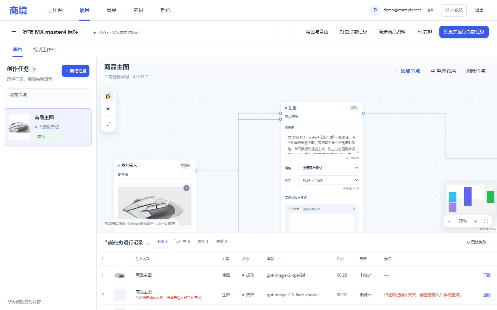

# 商境 · 企业级 AI 电商内容工作台

面向电商团队的企业级 AI 内容生产平台：商品长期聊天、项目画布、图片生成、视频分镜、素材管理与权限审计。

- 在线展示页：<https://ai-kaffey.github.io/shangjing-showcase/>
- 当前网络镜像：<https://htmlpreview.github.io/?https://raw.githubusercontent.com/Ai-Kaffey/shangjing-showcase/main/index.html>
- 展示内容：真实运行界面截图、能力说明、主流程与架构

## 在线体验

- 地址：<http://110.42.51.234:38173>
- 内容运营：`experience@shangjing.local` / `Enterprise2026!@`
- 只读审计：`reviewer@shangjing.local` / `Enterprise2026!@`

在线体验环境部署在独立实例 `110.42.51.234`，使用独立数据库、独立对象存储与独立应用容器；请勿上传真实资料或密钥。

本仓库仅包含静态展示页与界面截图，不包含应用源码、密钥或运维资料。源码仓库保持私有，可按需单独授权访问。
