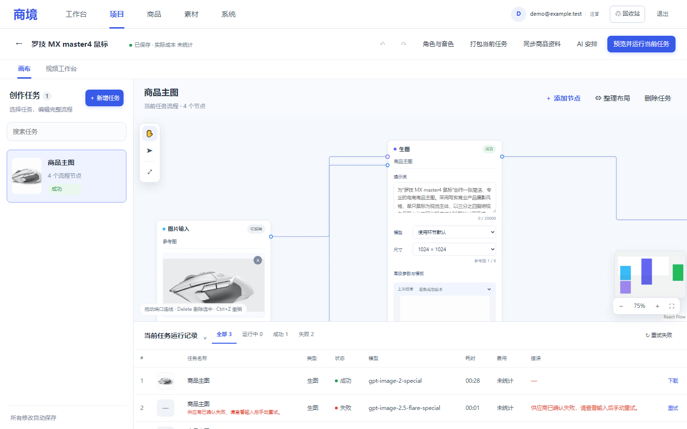

# 商境 · 企业级 AI 电商内容工作台

面向电商团队的企业级 AI 内容生产平台：商品长期聊天、项目画布、图片生成、视频分镜、素材管理与权限审计。

- 在线展示页：<https://ai-kaffey.github.io/shangjing-showcase/>
- 当前网络镜像：<https://htmlpreview.github.io/?https://raw.githubusercontent.com/Ai-Kaffey/shangjing-showcase/main/index.html>
- 展示内容：真实运行界面截图、能力说明、主流程与架构

## 在线体验

- 地址：<https://critical-warranty-allan-listen.trycloudflare.com/>
- 运营账号：`experience@shangjing.test` / `Experience2026!@`
- 只读账号：`viewer@shangjing.test` / `Viewer2026!@`

在线体验环境使用独立数据库、独立对象存储和本地模型沙箱，不调用外部付费供应商、不产生费用。体验数据会定期重置，请勿上传真实资料。

本仓库仅包含静态展示页与界面截图，不包含应用源码、密钥或运维资料。源码仓库保持私有，可按需单独授权访问。
